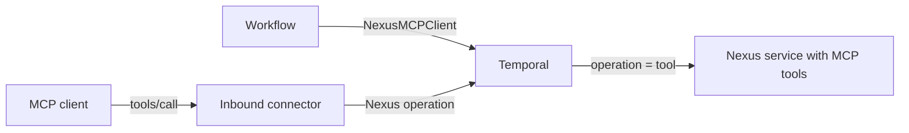

# Nexus MCP Connector

Connect MCP clients and servers through Temporal Nexus.

- **Inbound:** serve Nexus operations as MCP tools to any MCP client.
- **Outbound:** proxy upstream MCP servers. Tool calls run as Nexus operations backed by Standalone
  Activities.
- **Authoring:** mark Nexus operations as MCP tools.
- **Workflow client:** call Nexus-backed MCP tools from Workflow code.

> [!NOTE]
> This project is currently experimental. APIs are subject to change.

## Packages

| Language | Package | Docs |
| --- | --- | --- |
| Go | `github.com/temporalio/nexus-connector-mcp/go` | [go/README.md](go/README.md) |
| Python | `temporalio-nexus-mcp` | [python/README.md](python/README.md) |
| TypeScript | `@temporalio/nexus-mcp` | [typescript/README.md](typescript/README.md) |

## How it works

- A Nexus service marks its operations as MCP tools. It also gets a `list_tools` operation.
- The tool name is the Nexus operation name. The tool schemas come from the operation types.
- MCP clients reach the tools through the inbound connector. Workflows reach them through
  `NexusMCPClient`.
- Temporal runs each tool call as a durable Nexus operation.

## Development

See [CONTRIBUTING.md](.github/CONTRIBUTING.md).

## License

[MIT](LICENSE)
