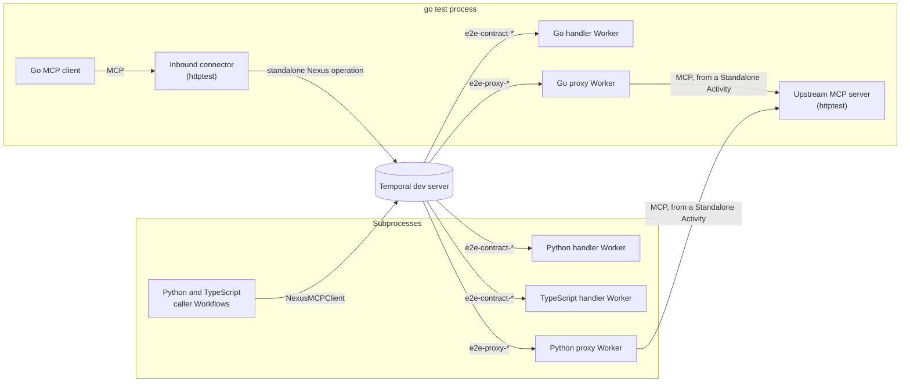

# E2E tests

The e2e tests run the inbound connector, the outbound proxy, the authoring helpers, and the Workflow
client of every language against each other. Every part runs for real: the Temporal dev server, the
SDK Workers, and the MCP clients and servers.

## Run

```bash
mise run e2e
```

The task builds the TypeScript package and fixtures, then runs `go test -tags e2e` in this directory.
Run one cell with `-run`:

```bash
cd e2e_tests && go test -tags e2e -run 'TestHandlerKinds/typescript/start_update' .
```

| Variable | Purpose |
| --- | --- |
| `TEMPORAL_ADDRESS` | Use a running dev server instead of starting one. Start it with the flags in `harness/env.go`. |
| `E2E_LOG_DIR` | Directory for the dev server and fixture logs. Defaults to a temp directory. |

## Architecture



### Processes

- **Go fixtures run in the test process.** These are the inbound connector, the Go handler and
  proxy Workers, the upstream MCP server, and the Go MCP client.
- **Python and TypeScript fixtures run as subprocesses.** A long-running fixture prints `READY` when
  it serves. A caller reads one JSON call from stdin, runs one Workflow, and prints one JSON result.
  Every fixture exits when its stdin closes, so it also stops when the test process dies.
- **One Temporal dev server serves all tests.** `TestMain` starts it with the flags in
  `harness/env.go`, or connects to `TEMPORAL_ADDRESS`.

### Fixture lifecycle

- `harness.Fixture` starts each fixture once, on first use. Parallel subtests share it. Examples are
  a handler Worker, a proxy Worker, a connector with one option set, and the upstream server.
- `env.Stop` stops the fixtures in reverse order, then the dev server.
- A tool call has a one-minute limit, so a broken path fails instead of hanging.

### Routing

Each handler language has its own task queue, `contract-<lang>`, and its own Nexus endpoint,
`e2e-contract-<lang>`. Each proxy language has `proxy-<lang>` and `e2e-proxy-<lang>`. A test picks
the language that serves a call by the endpoint it calls.

### Contract

Every handler implements the service in `contract/` with the same operation names and types. Each
echo operation returns `{message, kind}`. `kind` names the Temporal primitive that ran: `sync`,
`workflow`, `activity`, or `update`. The tests check every language against one expected value per
operation.

### Call paths

| Matrix | Path |
| --- | --- |
| Handler kinds, inbound modes | Go MCP client → inbound connector → standalone Nexus operation → handler Worker. |
| Cross-language | The path above, or a caller Workflow → `NexusMCPClient` → Nexus operation → handler Worker. |
| Outbound | Any caller → proxy Worker → Standalone Activity → upstream MCP server. Through the connector, this is the full chain: MCP client → inbound connector → proxy → upstream. |
| Schema parity | Go MCP client → inbound connector → `list_tools` of each handler Worker. |

## Matrices

| Test | Cells |
| --- | --- |
| `TestHandlerKinds` | Handler language × operation kind: sync, Workflow run, Workflow start, Activity, Update. |
| `TestCrossLanguage` | Caller × handler language × {sync, Workflow run, failure}. Callers: Go MCP client through the inbound connector, Python and TypeScript Workflows with `NexusMCPClient`. |
| `TestSchemaParity` | `list_tools` of the Go, Python, and TypeScript handlers. |
| `TestToolCall…`, `TestReturnTask…`, `TestTaskCancel…`, `TestClientCancel…`, `TestUnknownTool…` | Inbound call modes: tasks, the wait budget, cancellation, and tool errors. |
| `TestOutbound…` | Caller × proxy language × upstream tool: result, tool error, JSON-RPC error, a tool new upstream, an unknown tool. |

## Layout

| Path | Contents |
| --- | --- |
| `contract/` | The contract service: operation names, types, and expected results. |
| `harness/` | Dev server, Nexus endpoints, fixture processes, and MCP clients. |
| `fixtures/go/` | Go handler, proxy, and upstream MCP server. They run in the test process. |
| `fixtures/python/` | Python handler, proxy, and Workflow caller. They run as subprocesses. |
| `fixtures/typescript/` | TypeScript handler and Workflow caller. They run as subprocesses. |
