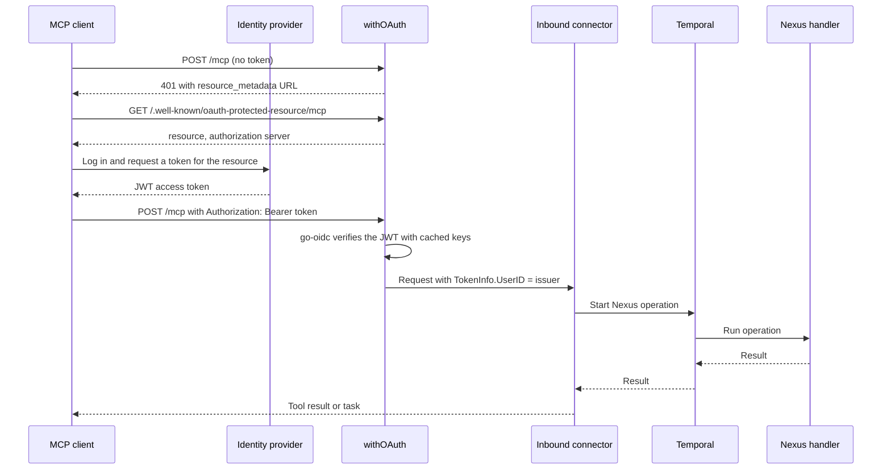

# OAuth inbound connector

A sample host that serves the inbound connector over Streamable HTTP behind OAuth. The connector is
an OAuth resource server. It accepts JWT access tokens from one trusted issuer.

| File | Contents |
| --- | --- |
| [`main.go`](main.go) | Connector usage: dial Temporal, call `inbound.NewServer`, serve it over HTTP. |
| [`oauth.go`](oauth.go) | OAuth: `withOAuth` wraps the MCP handler. |

## Run

```bash
go run . \
  -resource https://connector.example.com/mcp \
  -issuer https://login.example.com \
  -audience https://connector.example.com \
  -endpoint weather-endpoint \
  -service weather
```

| Flag | Purpose |
| --- | --- |
| `-resource` | Public MCP URL. The sample serves MCP on its path. |
| `-issuer` | Token issuer. It must serve OIDC discovery. |
| `-audience` | Required `aud` claim. |
| `-scope` | Optional required scope, such as `mcp:access`. |
| `-endpoint`, `-service` | Nexus endpoint and service. |
| `-temporal`, `-namespace` | Temporal address and connector namespace. |
| `-addr` | Listen address. Defaults to `:8080`. |

Serve the sample behind HTTPS. The MCP client handles login and token refresh.

## How OAuth is wired

`withOAuth` uses two libraries:

- [`go-oidc`](https://github.com/coreos/go-oidc) reads the issuer discovery document, fetches and
  caches the signing keys, and checks the signature, issuer, audience, and expiry of each token.
- The MCP SDK [`auth`](https://pkg.go.dev/github.com/modelcontextprotocol/go-sdk/auth) package
  reads the bearer token, checks scopes, returns `401` challenges, and serves the protected resource
  metadata (RFC 9728).

The verifier sets `TokenInfo.UserID` to `issuer#subject`. The connector reads it to bind each task
to its caller. The connector does not send tokens to Temporal.



To use another token verifier, replace the `verify` function in `oauth.go`. Set `UserID` to a
stable caller identity. If your middleware does not set the MCP SDK token info, set
`inbound.Options.CallerIdentity`.
