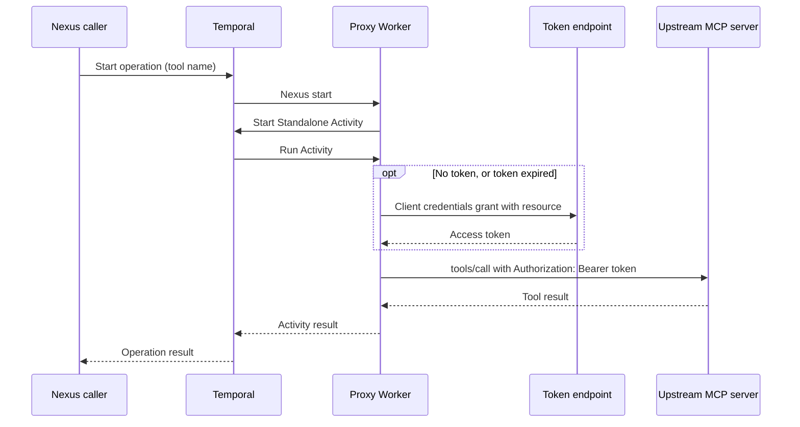

# OAuth outbound connector

A sample Worker that proxies an upstream MCP server that requires OAuth. The Worker is an OAuth
client. It gets access tokens with the client credentials grant.

| File | Contents |
| --- | --- |
| [`main.go`](main.go) | Connector usage: dial Temporal, call `outbound.NewPlugin`, run the Worker. |
| [`oauth.go`](oauth.go) | OAuth: `oauthHTTPClient` returns an HTTP client that adds the access token. |

## Run

```bash
OAUTH_CLIENT_SECRET=... go run . \
  -upstream https://mcp.example.com/mcp \
  -token-url https://login.example.com/oauth/token \
  -client-id mcp-proxy \
  -service weather
```

| Flag | Purpose |
| --- | --- |
| `-upstream` | Upstream MCP URL. |
| `-token-url` | OAuth token endpoint. |
| `-client-id` | OAuth client ID. `OAUTH_CLIENT_SECRET` holds the secret. |
| `-scope` | Optional requested scopes, space separated. |
| `-service` | Nexus service name. |
| `-temporal`, `-namespace`, `-task-queue` | Temporal address, namespace, and Worker task queue. |

Create a Nexus endpoint that targets the task queue. Callers then call the upstream tools through
the endpoint.

## How OAuth is wired

`oauthHTTPClient` uses [`golang.org/x/oauth2/clientcredentials`](https://pkg.go.dev/golang.org/x/oauth2/clientcredentials):

- It gets a token from the token endpoint with the client ID and secret.
- It sends the upstream URL as the `resource` parameter (RFC 8707).
- It caches the token and gets a new one before it expires.
- It is safe for concurrent use, so all tool calls share one HTTP client.

The `ClientFactory` passes the HTTP client to the MCP SDK `StreamableClientTransport`. Each request
to the upstream has an `Authorization: Bearer` header. The tokens and the secret stay in the Worker
and are not sent to Temporal.


