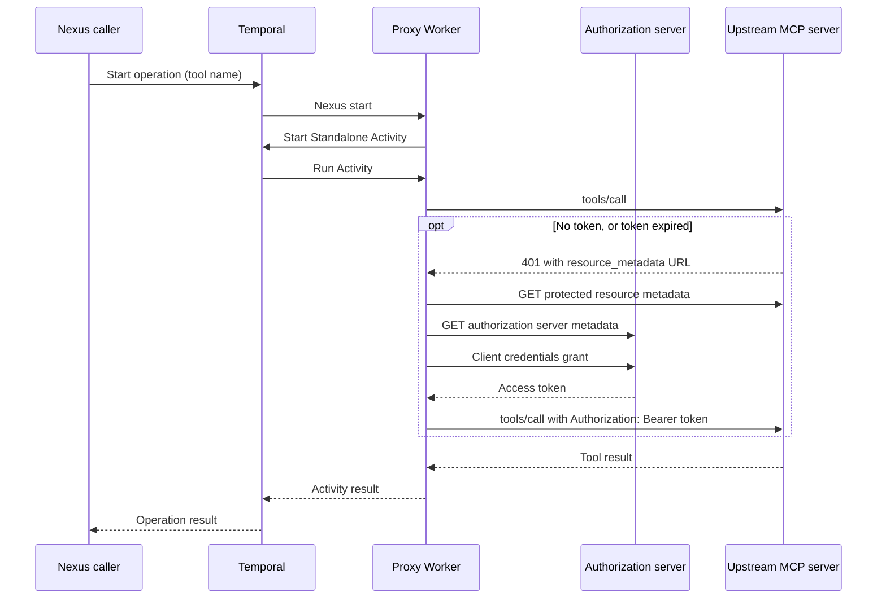

# OAuth outbound connector

A sample Worker that proxies an upstream MCP server that requires OAuth. The Worker is an OAuth
client. It gets access tokens with the client credentials grant.

| File | Contents |
| --- | --- |
| [`main.py`](main.py) | Connector usage: connect to Temporal, create `MCPProxyPlugin`, run the Worker. |
| [`oauth.py`](oauth.py) | OAuth: `oauth_http_client` returns an HTTP client that adds the access token. |

## Run

Run from the [`python`](../../../python) directory, so `uv` uses its environment:

```bash
OAUTH_CLIENT_SECRET=... uv run ../samples/python/oauth_outbound_connector/main.py \
  --upstream https://mcp.example.com/mcp \
  --issuer https://login.example.com \
  --client-id mcp-proxy \
  --service weather
```

| Argument | Purpose |
| --- | --- |
| `--upstream` | Upstream MCP URL. |
| `--issuer` | OAuth authorization server issuer. |
| `--client-id` | OAuth client ID. `OAUTH_CLIENT_SECRET` holds the secret. |
| `--scope` | Optional requested scopes, space separated. |
| `--service` | Nexus service name. |
| `--temporal`, `--namespace`, `--task-queue` | Temporal address, namespace, and Worker task queue. |

Create a Nexus endpoint that targets the task queue. Callers then call the upstream tools through
the endpoint.

## How OAuth is wired

`oauth_http_client` uses the MCP SDK
[`ClientCredentialsOAuthProvider`](https://github.com/modelcontextprotocol/python-sdk):

- On the first `401`, it reads the protected resource metadata of the upstream (RFC 9728) and the
  authorization server metadata (RFC 8414).
- It sends the credentials only to the authorization server of `--issuer`.
- It gets a token with the client ID and secret, and caches it.
- It holds a lock, so all tool calls share one HTTP client.

The `client_factory` passes the HTTP client to the MCP SDK `streamable_http_client`. Each request
to the upstream has an `Authorization: Bearer` header. The tokens and the secret stay in the Worker
and are not sent to Temporal.


